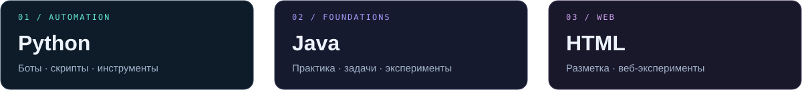
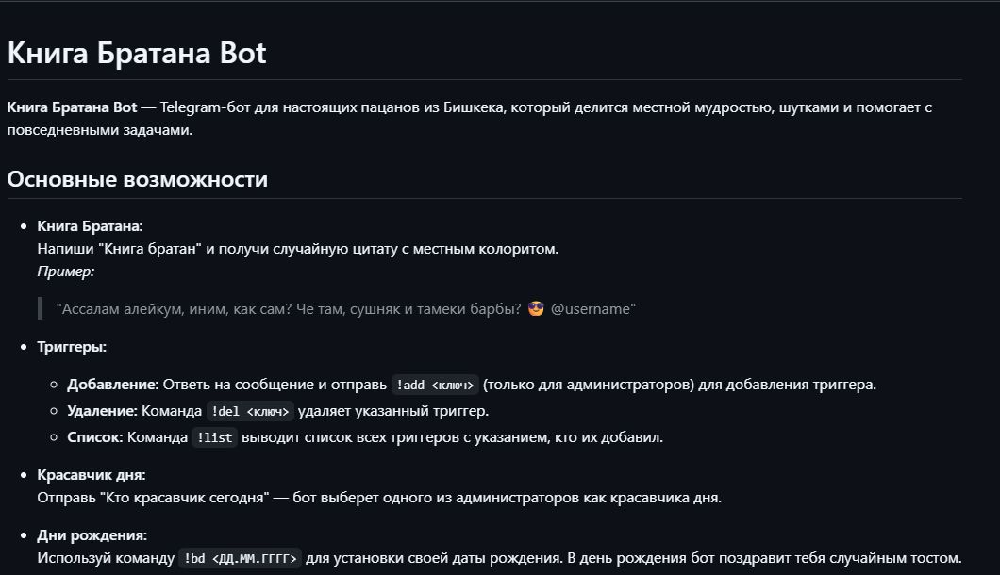
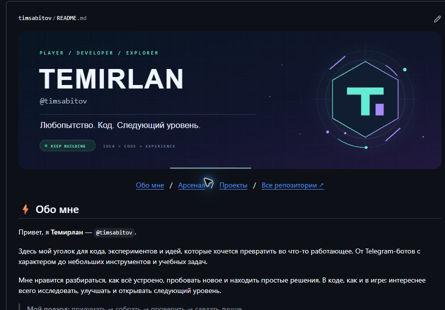

  

  <a href="#-обо-мне">Обо мне</a> &nbsp; / &nbsp;
  <a href="#-арсенал">Арсенал</a> &nbsp; / &nbsp;
  <a href="#-витрина-проектов">Проекты</a> &nbsp; / &nbsp;
  <a href="#-неоновый-след">Активность</a> &nbsp; / &nbsp;
  <a href="https://github.com/timsabitov?tab=repositories">Репозитории ↗</a>

## ⚡ Обо мне

Привет, я **Темирлан** — `@timsabitov`. Здесь моя мастерская: Telegram-боты с характером, небольшие инструменты и эксперименты с кодом.

Мне нравится разбираться, как всё устроено, пробовать новое и открывать следующий уровень. **Придумать → собрать → проверить → сделать лучше.**

## 🧰 Арсенал

## 🎮 Витрина проектов

<table>
<tr>
<td width="50%" valign="top">

### 01 / Книга Братана
**Telegram-бот с местным колоритом**

Цитаты, настраиваемые триггеры, поздравления и статистика активности чата. У беседы появляется свой характер.

`Python` · `Telegram` · `Community`

[Посмотреть проект ↗](https://github.com/timsabitov/kniga_bratan_bot)

На снимке — публичная документация бота.

</td>
<td width="50%" valign="top">

### 02 / Neon Workshop
**Этот профиль — тоже проект**

Собственная эмблема, орбитальная шапка, анимированный терминал и неоновая змейка. Личная мастерская в стиле sci-fi.

`SVG` · `Markdown` · `GitHub Actions`

[Открыть мастерскую ↗](https://github.com/timsabitov/timsabitov)

На снимке — оформление профиля до этого обновления.

</td>
</tr>
</table>

<b>🗃️ Учебные репозитории и эксперименты</b>

 

- [gitStart](https://github.com/timsabitov/gitStart) — учебный Java-репозиторий, форк исходного проекта.
- [test123456](https://github.com/timsabitov/test123456) — учебный эксперимент.
- [Все репозитории ↗](https://github.com/timsabitov?tab=repositories)

## 🐍 Неоновый след

Мой график вкладов превращается в маршрут: бирюзовая змейка собирает фиолетовые клетки.

Обновляется ежедневно · <a href="https://github.com/timsabitov/timsabitov/actions/workflows/neon-snake.yml">Статус обновления</a> · <a href="https://github.com/Platane/snk">Создано с Platane/snk</a>

---

  <b>Маленькие шаги. Рабочий код. Новые уровни.</b> 
  Спасибо, что заглянул в мою мастерскую ✦

